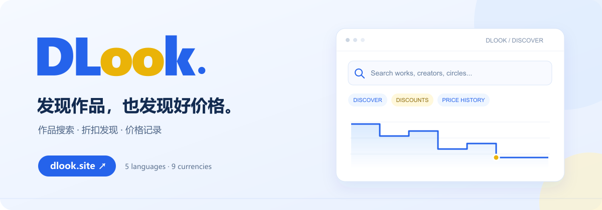

  

<h1 align="center">DLook</h1>

<strong>发现作品，也发现好价格。</strong>

DLsite 作品搜索、折扣发现与价格记录查询网站

  
  
  
  

  <a href="https://dlook.site"><strong>立即体验</strong></a> ·
  <a href="https://dlook.site/?screen=sale">正在打折</a> ·
  <a href="https://dlook.site/?screen=lowest">历史低价</a> ·
  <a href="https://github.com/CbShuiMu/DLook/issues">问题与建议</a>

---

## 让找作品、看折扣更轻松

记得作品名，也许只记得作者、社团或品牌？在 DLook 输入关键词，就能搜索已收录的作品，再按类型、语言、价格和发售日期逐步缩小范围。

从发现感兴趣的作品，到查看折扣、了解价格记录、寻找官方翻译版，把购买前想了解的信息放在一起。

## 你可以用 DLook 做什么

| 功能 | 带来的便利 |
| --- | --- |
| **一键搜索** | 支持作品名、作者、社团、品牌及商品编号；输入时提供名称建议，帮助更快定位目标。 |
| **折扣发现** | 集中浏览正在打折的作品，按折扣力度或价格排序，寻找符合预算的选择。 |
| **历史低价与价格记录** | 查看已记录的促销价格走势，识别达到记录内低价的作品，给购买时机多一份参考。 |
| **按喜好筛选** | 按商品类型、作品语言、官方翻译、日元价格范围等条件筛选，并保留分页与排序。 |
| **作者与社团作品页** | 从作品中的作者、社团或品牌标签继续浏览，发现同一创作者的其他作品。 |
| **关联语言版本** | 在详情中查看依据官方语言选择器收录的关联版本，区分原版与翻译版。 |
| **多语言、多币种** | 用熟悉的界面语言浏览，并将日元价格换算为常用币种供参考。 |
| **随处浏览** | 适配手机与桌面，自动跟随系统深色模式；搜索、筛选及作品链接可以分享。 |

## 三步开始

1. **打开 [dlook.site](https://dlook.site)**，输入作品名、作者、社团、品牌或商品编号。
2. **调整筛选条件**，选择作品语言、类型和预算；也可以直接进入[正在打折](https://dlook.site/?screen=sale)或[历史低价](https://dlook.site/?screen=lowest)。
3. **打开作品详情**，查看价格记录、关联版本及官方来源，再到 DLsite 确认商品信息。

无需安装客户端，打开浏览器即可使用。

## 用熟悉的语言与币种浏览

**界面语言：** 中文 · English · 日本語 · 한국어 · ไทย

**显示币种：** CNY · JPY · USD · KRW · THB · AUD · CAD · GBP · EUR

界面语言与作品语言可以分别选择，作品标题和创作者名称保留来源原文。换算价格会标明汇率日期；排序、价格范围及低价比较以原始日元价格为准。

## 关于数据与价格

- 作品信息与关联版本依据 DLsite 的公开资料整理，目录持续更新；不同地区可访问的内容及导航可能不同。
- “历史低价”指 **DLook 已收录、已生效的价格记录范围内**的低价，不能代表平台完整历史或未来最低价。
- 价格与折扣可能在更新间隔内变化，币种换算供参考；商品信息、活动条件及结算金额请以 DLsite 官方页面为准。
- DLook 是独立的作品信息与价格查询网站，与 DLsite 无隶属关系。作品名称、封面及商标等权利归各自权利人所有。

[隐私政策](https://dlook.site/privacy) · [服务条款](https://dlook.site/terms) · [网站地图](https://dlook.site/sitemap)

## 反馈与支持

发现页面问题、信息缺失，或有想增加的功能？欢迎在 [Issues](https://github.com/CbShuiMu/DLook/issues) 留下建议。涉及具体作品时，可以附上商品编号、页面链接和复现步骤，请勿提交账号或支付等私人信息。

如果 DLook 帮你找到了喜欢的作品，欢迎 **Star** 这个仓库，或将 [dlook.site](https://dlook.site) 分享给同样需要的人。

本仓库用于 DLook 网站介绍、展示素材与问题反馈。

---

### Discover DLook

**Find your next favorite — and a better price.**

DLook helps you discover DLsite works, browse discounts, explore recorded price history, and find related language editions. Search by title, creator, circle, brand, or product ID, with five interface languages, nine display currencies, and layouts for mobile and desktop.

Historical lows reflect the records collected by DLook. Availability varies by region; check DLsite for current prices and purchase conditions. DLook is an independent service and is not affiliated with DLsite.

**[Visit dlook.site →](https://dlook.site)**
